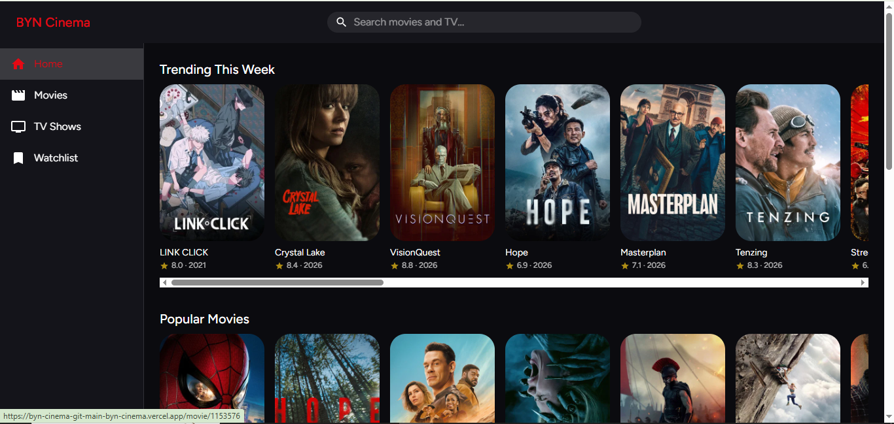
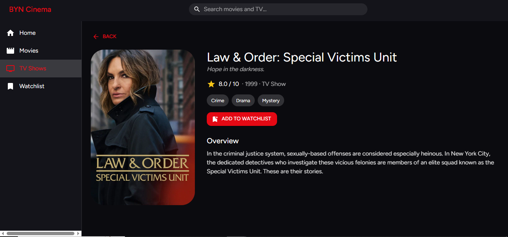

# BYN Cinema

A movie and TV discovery web app built with React, Material UI and the TMDB API.

<<<<<<< HEAD
**Live demo:** https://byn-cinema-git-main-byn-cinema.vercel.app/
=======
**Live demo:**https://byn-cinema-git-main-byn-cinema.vercel.app/ 
>>>>>>> 4a752ed8de2765151aba345e847005917f61eb86
**Repository:** https://github.com/MUKISA-BRIAN/byn-Cinema

## Screenshots

## Features

- Dark theme with a top bar, search box and sidebar (a slide-in menu on mobile)
- Content rows on the home page: Trending, Popular Movies, Action Movies, Popular TV Shows
- Live data from the TMDB API, with no hardcoded catalogue
- Search for movies and TV shows, with loading, error and "no results" messages
- Details page with poster, overview, release date, rating and genres
- Movies and TV Shows pages with a genre filter and pagination
- Watchlist saved in localStorage, so it survives a refresh
- Fallbacks for missing posters and missing data

## Tech stack

React, Vite, Material UI, React Router, TMDB API, Vercel

## Protecting the API key

The browser never sees the TMDB key. The app calls `/api/tmdb/...`, and a proxy adds the key. Locally this is the Vite dev server (`vite.config.js`). In production it is a Vercel serverless function (`api/tmdb.js`), with the key stored as an environment variable.

## Run locally

1. Clone the repository and run `npm install`
2. Get a free API key (v3) at themoviedb.org
3. Copy `.env.example` to `.env` and set `TMDB_API_KEY=your_key_here`
<<<<<<< HEAD
4. Run `npm run dev`
=======
4. Run `npm run dev`
>>>>>>> 4a752ed8de2765151aba345e847005917f61eb86
